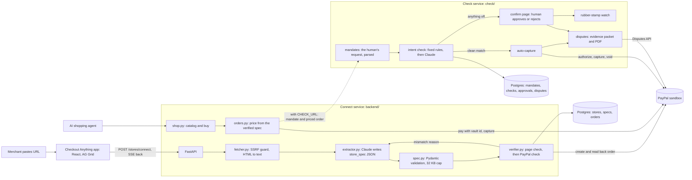

# Checkout Anything

Checkout Anything opens any store to AI agents, and makes sure every agent order is one the human actually meant.

Built for the PayPal AI Hackathon. Sandbox only, fictional stores only.

PayPal's agentic commerce products (Agent Ready and Store Sync) reach merchants through supported platforms such as Wix, BigCommerce, Shopware and Cymbio. Everyone else is invisible to AI shopping agents: a hand-coded HTML shop, an artist with a commission price list, a bakery with a menu page. And once agents can buy, a merchant has no way to know whether the human behind the agent wanted that order. Checkout Anything covers both, in three features.

## Connect

Any store becomes buyable by an agent, from just its URL, in about a minute.

1. The merchant pastes their store URL.
2. Claude reads the page and writes a `store_spec`, a declarative JSON description of what is for sale and at what price.
3. Fixed Python code verifies the spec. For every item it checks the price against the page, then creates a real PayPal sandbox order and checks what PayPal holds against the spec. On a mismatch Claude repairs the item (3 tries at most). Every step streams live to the UI.
4. The verified store gets a buy endpoint. Any AI shopping agent can now buy from it through PayPal, and a Claude shopping agent does, paying with a vaulted sandbox wallet.

No integration is needed on the store's side. That is the difference from tools built on PayPal's Store Sync Cart API, which only work for shops that are already wired into PayPal.

## Check

Every agent order is held until it is shown to be what the human asked for.

1. The human's request to their agent is saved as a mandate: the item, the limits, the store.
2. The payment is authorized at PayPal but not captured.
3. Fixed rules (price cap, store, expiry, currency) and then Claude compare the order with the mandate.
4. A clean match is captured on its own. Anything off goes to the human on a one-screen confirm page with a one-line reason: approve captures, reject voids.
5. A rubber-stamp watch times the approvals. When the human stops really reading them, it asks less often but more pointedly.

## Defend

When a buyer disputes a captured order, the merchant already holds the proof. Checkout Anything finds the dispute through PayPal's Disputes API, builds a packet from its own records (what the buyer asked for, what was ordered, how it was checked, who released the money and how long they took), has Claude draft a plain summary of it, and files both with PayPal as evidence.

Check and Defend have their own API reference in [`check/docs/api.md`](check/docs/api.md) and setup notes in [`check/README.md`](check/README.md).

## Architecture

One product, two backends. The Connect service is in `backend/` and `frontend/`. The Check service, which also does Defend, is in `check/`. Each has its own database, and both deploy from the one `render.yaml`.

The two are joined by one setting, `CHECK_URL`, on the Connect service. Left empty, the shopping agent's orders are paid and captured by the Connect service, as in the Connect section above. Set, they take the dashed arrow instead: the human's own request goes to Check as a mandate, the priced order follows, and Check holds the payment, checks it and captures it or asks the human. The merchant stays in the one app: the Orders grid shows the check result, the one-line reason, the review state and how long the human took, links to the buyer's confirm page, and a Disputes tab covers Defend.



## How verification works

The rule the whole project is built on: **Claude only ever writes `store_spec` JSON. It never writes code and never calls PayPal.** Every PayPal call comes from fixed, tested Python.

For each available item, one at a time:

1. **Page check (no AI).** The item's `source_quote` has to appear in the fetched page text, and the price inside the quote has to equal `unit_price`. Crossed-out prices do not count. Variant and add-on prices have to be prices that appear on the page.
2. **PayPal check.** The code creates a real Orders v2 sandbox order for one unit (intent `CAPTURE`), reads it back with a second call, and compares the amount, currency and item name PayPal returns against the spec.
3. **Pass:** the row turns verified and shows the PayPal order id.
4. **Fail:** the exact reason is shown, Claude gets the reason plus the page text and the item, returns a repaired item, and the checks run again. After 3 repairs the item stays failed with its reason. There is no template fallback and no fake success.

A store is live once at least one item is verified. Only verified items can be bought.

**Verification orders are never captured.** They are created with no payment source, so nobody is charged and no money moves. PayPal's Orders v2 schema says the caller has 6 hours from creation (the default) to send a payer to approve an order, so these orders simply lapse. PayPal's docs do not say what an expired order looks like afterwards, and we never read them again.

**Buying.** `POST /stores/{id}/orders` takes an item id, an optional variant, add-ons and a quantity. It has no price field and rejects requests that send one. The total is computed from the verified spec: (variant price or item price, plus add-ons) times quantity, plus flat shipping once. The order is created with `payment_source.paypal.vault_id`, which captures in the same call, and it only counts as a success if the capture status is `COMPLETED` and the captured amount equals the computed total.

**Fetching safely.** The URL is user input, so the fetcher only allows http and https, refuses any host that resolves to a private or internal address, checks the address it actually connected to before reading the body, follows at most 3 redirects with the same checks on each hop, and caps the page at 2 MB and 10 seconds.

## The `store_spec`

```json
{
  "spec_version": 1,
  "source_url": "https://.../hollowbrook-bakery/",
  "merchant": { "name": "Hollowbrook Bakery", "currency": "USD" },
  "items": [
    {
      "id": "sourdough-loaf",
      "name": "Sourdough Loaf",
      "description": "48 hour ferment, crackly crust",
      "unit_price": "9.00",
      "available": true,
      "variants": [{ "id": "half", "label": "Half loaf", "unit_price": "5.00" }],
      "add_ons": [{ "id": "sliced", "label": "Sliced", "price": "1.00" }],
      "source_quote": "Sourdough Loaf 48 hour ferment, crackly crust | $9"
    }
  ],
  "shipping": { "type": "flat", "amount": "6.00", "notes": "Local delivery only" },
  "extraction_notes": ["Butter Croissant is marked SOLD OUT, set available=false"]
}
```

Prices are strings with 2 decimals, never floats. Unknown fields are rejected. The serialized spec is capped at 32 KB. Every version is kept, so the repair history is visible in the UI.

## Run it locally

You need Python 3.11 or newer, Node 20 or newer, a PayPal sandbox app and an Anthropic API key.

On Windows (cmd), from the repo root:

```
copy .env.example .env
```

Fill in `.env`, then:

```
dev.cmd
```

That installs everything and opens three windows: the API on 8000, the app on 5173, the demo stores on 5174. Open http://localhost:5173.

It also starts the Check API on 8001 once `check/.env` is filled in (the first run creates it from `check/.env.example`). The Check service needs a Postgres database, see [`check/README.md`](check/README.md).

### Keys

| Variable | What |
|---|---|
| `PAYPAL_CLIENT_ID`, `PAYPAL_CLIENT_SECRET` | A sandbox REST app from developer.paypal.com (Apps & Credentials, Sandbox). Turn on Vault for the app. |
| `ANTHROPIC_API_KEY` | For live mode and the shopping agent. Replay mode connects stores without it. |
| `BUYER_VAULT_ID` | The saved sandbox buyer wallet the buy endpoint pays with. See below. |
| `CHECK_URL` | Optional. The Check service's URL (`http://127.0.0.1:8001` locally). Left empty, agent orders are paid and captured here and nothing else in this table below is used. |
| `CHECK_AGENT_KEY` | One of the Check service's `AGENT_API_KEYS`. Its name there also has to be in the Check service's `STORE_NAMING_AGENTS`, or Check ignores the store name and holds every order for review. |
| `CHECK_MERCHANT_KEY` | The Check service's `MERCHANT_API_KEY`. Lets the Orders grid show why an order was held, make review links and run the Disputes tab. |
| `CHECK_FRONTEND_URL` | Where the Check frontend is served, for the buyer's confirm page (`http://localhost:5175` locally). |

To get `BUYER_VAULT_ID`, run this once and approve in the browser as your sandbox buyer (the personal account under Testing Tools, Sandbox Accounts):

```
python backend\scripts\setup_vault.py
```

It makes a $1.00 sandbox order that asks to save the wallet, waits for you to approve it, captures it and prints the id.

### Sandbox buyer login for judges

TODO (Bhavi): add the sandbox buyer email and password here before submitting. Judges do not need it to use the hosted demo, the agent pays with the saved wallet. It is only needed to look at the buyer's side in the PayPal sandbox.

### Tests

```
pytest
```

The tests fake PayPal, Claude and the page fetch, so they need no keys and no network. They cover spec validation, the page check, price math (variants, add-ons, quantity, shipping), the SSRF guard, the verify and repair loop, and the API end to end.

One test really talks to the sandbox. It is off by default:

```
pytest -m live_sandbox
```

The Check service's tests are separate and run from its folder: `cd check`, then `pytest`. CI runs both suites.

## Judge mode

The hosted app runs live by default: it fetches the page and calls Claude. The **Replay mode** toggle in the top bar switches connect runs to recorded fixtures, so the demo keeps working if a page changes or a Claude call fails. In replay mode:

- the page text and Claude's answers come from `backend/fixtures/<store>.json`, recorded from a real run
- everything from a fixture is labelled **FIXTURE** in the UI
- the verify loop and every PayPal sandbox call still run for real

**Reset demo** wipes the stores and orders kept by this app and reconnects the three demo stores. Orders at PayPal are not touched.

Fixtures are recorded, never written by hand. With the API running with `RECORD_FIXTURES=1`:

```
python backend\scripts\record_fixtures.py
```

A store with no fixture fails with a clear error in replay mode.

## The demo stores

Three fictional stores, each messier than the last:

1. **Fernwood & Thistle Goods**: a clean product grid, 6 items, one with S/M/L variants.
2. **Quill & Pipkin Studio**: an illustrator's commission page written as prose, with a flat add-on and a percentage rule. The percentage cannot be represented, so the extractor leaves it out and says so in its notes.
3. **Hollowbrook Bakery**: a menu with a sold out item, a crossed-out old price, a half loaf variant and a price that is only in a footnote.

The names were searched before use and are not real businesses as far as we could find.

## API

| Method | Path | What |
|---|---|---|
| POST | `/stores/connect` | start connecting a URL (`{"url": "...", "mode": "live" or "replay"}`) |
| GET | `/stores/{id}/events` | Server-Sent Events stream of the connect run |
| GET | `/stores` | stores and their status |
| GET | `/stores/{id}/catalog` | verified items only |
| GET | `/stores/{id}/spec` | full spec, extraction notes, version history, verification attempts |
| POST | `/stores/{id}/orders` | buy (price computed server-side) |
| POST | `/agent/chat` | the demo shopping agent |
| GET | `/orders` | all orders, with the Check result on the ones that went through Check |
| POST | `/orders/{id}/review-link` | a link to the buyer's confirm page for an order on hold (needs `CHECK_URL`) |
| GET | `/disputes` | PayPal disputes on captured orders (needs `CHECK_URL`, like the three below) |
| POST | `/disputes/sync` | ask PayPal for new disputes |
| GET | `/disputes/{id}/evidence` | the evidence packet and its drafted summary |
| POST | `/disputes/{id}/redraft`, `/disputes/{id}/submit-evidence` | redraft the summary, file the evidence with PayPal |
| POST | `/demo/reset` | wipe demo data and reconnect the 3 demo stores |

Event types: `fetch.started`, `fetch.done`, `extract.started`, `extract.done`, `item.checking`, `item.verified`, `item.failed`, `item.repairing`, `store.ready`, `error`. Each carries `store_id`, `item_id` (if any), a one sentence `message`, and `data`.

## Built with

- **Claude (Anthropic API, Claude Sonnet 5.5)**: writes the `store_spec` through a strict tool call, repairs items that fail verification, and runs the shopping agent with tool use.
- **PayPal Orders v2, create order**: one real sandbox order per item during verification, and the paid order when an agent buys.
- **PayPal Orders v2, show order details**: reading each verification order back to compare PayPal's record with the spec.
- **PayPal Orders v2, capture**: the one-time wallet setup order. Vault-paid orders capture inside the create call.
- **PayPal Vault (payment tokens, saved PayPal wallet)**: the agent pays with `payment_source.paypal.vault_id`, so no buyer popup is needed.
- **PayPal Agent Toolkit (Python)**: the shopping agent's `check_payment` tool reads the order back through the Toolkit's `get_order_details`.
- **AG Grid Community**: the live catalog grid (row transactions, cell renderers, row flashing) and the orders grid (full-width group rows per store, quick filter).
- **FastAPI, SQLAlchemy, Postgres, React, Vite, Render.**

### Why the agent does not pay through the Agent Toolkit

The PayPal Agent Toolkit has no vault or payment token support. Its `create_order` builds an order that a buyer has to approve in a browser, and its `pay_order` only captures after that approval. An agent buying on its own has nobody to click, so the payment goes through our own buy endpoint with a vault id, and the Toolkit is used for reading the order back. The Python package also has no Claude integration, so we call its plain `PayPalAPI.run` entry point and pass the result to Claude ourselves. It is installed with `--no-deps` because it pins old versions of agent frameworks that this app never imports.

### AG Grid licensing

Only AG Grid Community is used. Grouping orders by store is done with full-width rows, a Community feature, instead of Enterprise row grouping.

## Known limitations

- Reads static HTML text only. No JavaScript-rendered stores, and no prices that only exist in images.
- Verification orders are created but never captured.
- Shipping is flat-rate only.
- Percentage add-ons are not supported. They are skipped and noted.
- Prices are recognised with `$`, `€`, `£` or a trailing `USD`, `EUR`, `GBP`. The demo stores are all USD.
- The merchant's PayPal account is the sandbox merchant from `.env`. A real version would need merchant onboarding.
- The live log of a connect run is kept in memory, so the API runs as a single process and the log of a finished run is gone after a restart. The verified result is in the database either way.
- The hosted demo has no login. Anyone with the link can connect a URL or reset the demo. With `CHECK_URL` set that also covers making a review link (and so approving or rejecting an order on hold) and filing dispute evidence, which the Check service's own dashboard keeps behind a login. Fine for a sandbox demo, not for real money.
- Only the shopping agent's orders go through Check. A manual test buy has no human request to check against, so it is paid and captured directly.
- Check is US dollars only, and its dispute summary and evidence PDF still name the original demo store (Fernwood Supply Co) as the merchant, whichever connected store the order was at.

## Credits

The overall shape comes from [ControlAnything](https://github.com/Apolotary/controlanything) (MIT): generated artifacts that are declarative and size-capped, a verify loop that tests against the real target and repairs on failure, the agent's work streaming live next to the thing being connected, and a judge mode that replays labelled fixtures. No code was copied, that project is Node and WebXR and this one is Python and React.

## History

Check and Defend started as a standalone prototype (codename Leash) on Oct 21 and were merged here with full history. That repo is [Bhavishaahuja/leash](https://github.com/Bhavishaahuja/leash), and `git log` here shows every one of its commits. The Connect service's PayPal client is adapted from it.

## License

MIT, see `LICENSE`.
