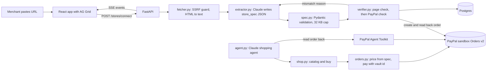
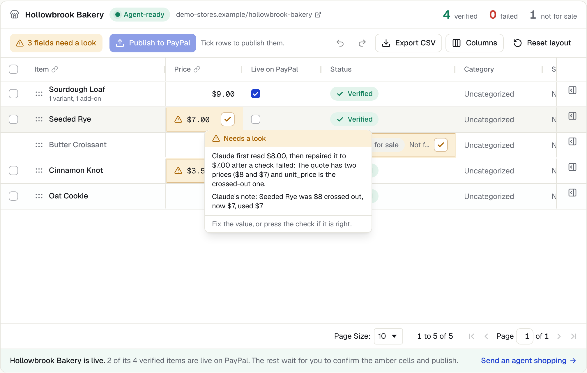
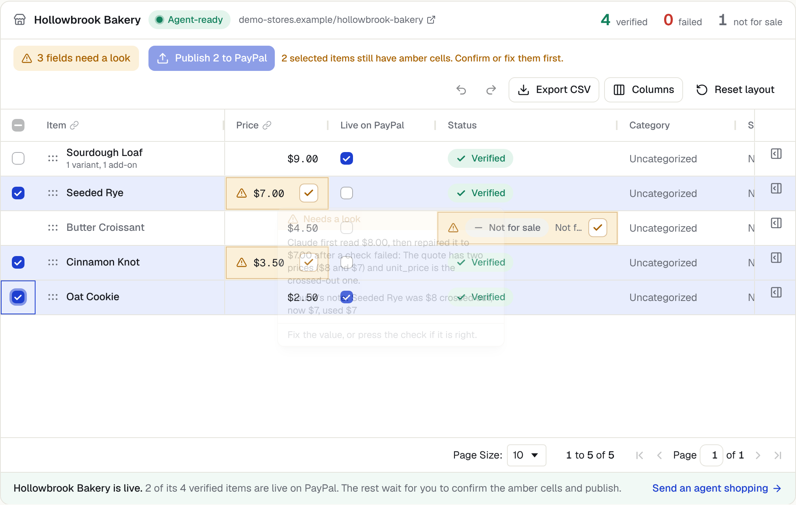
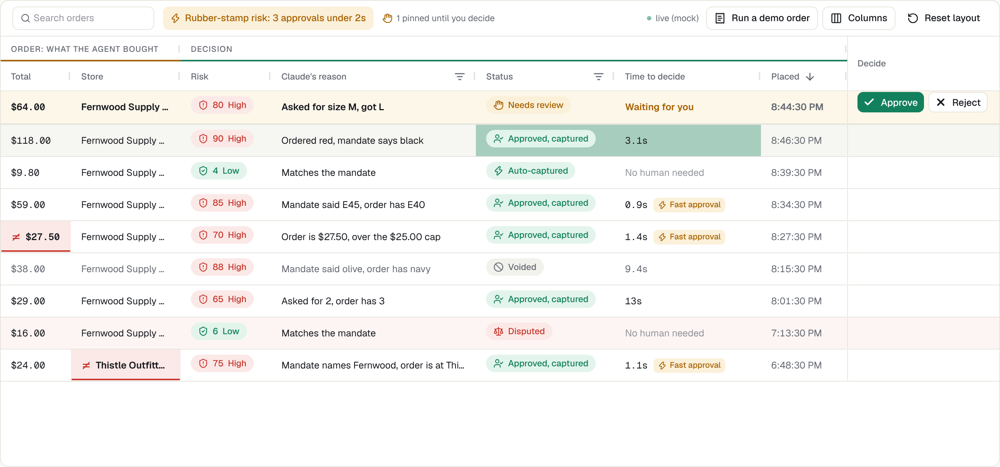
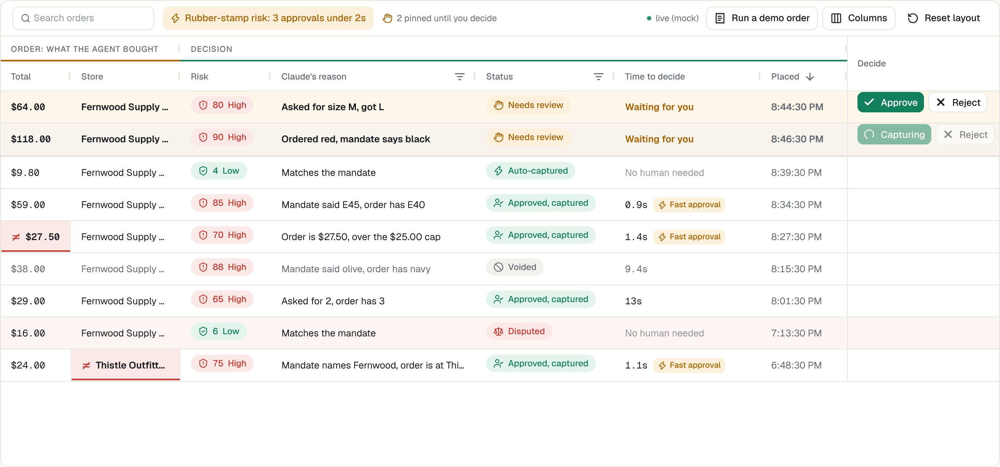
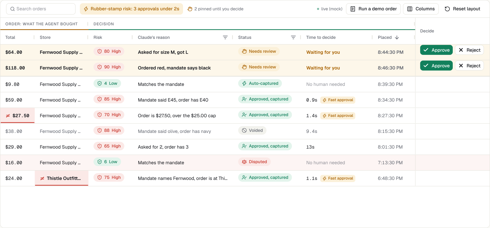
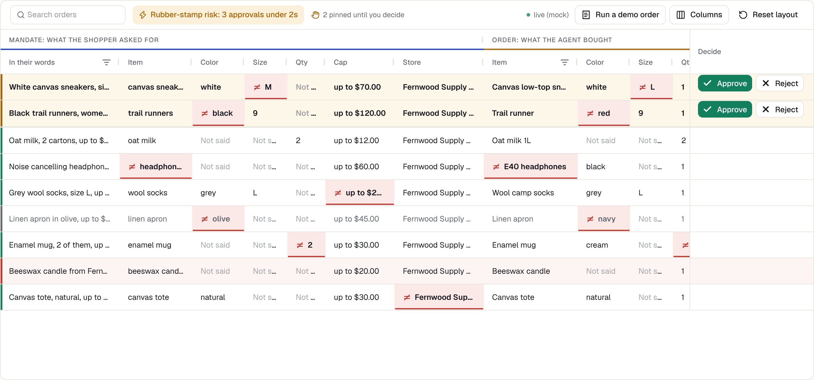
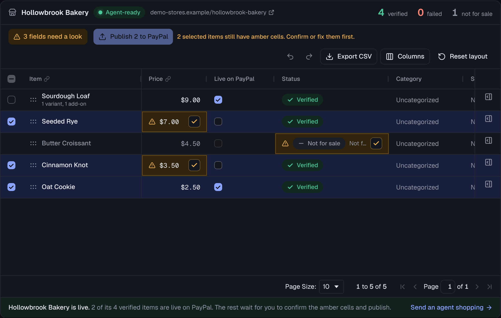

# Checkout Anything

PayPal made big stores agent-ready. Checkout Anything makes any store agent-ready from just a URL, in about a minute.

Checkout Anything makes any store agent-ready. [Leash](leash/README.md) makes sure every agent order is one the human meant.

Built for the PayPal AI Hackathon. Sandbox only, fictional stores only.

## Two projects, one repo

| Folder | What it is |
| --- | --- |
| `backend/`, `frontend/`, `demo-stores/` | **Checkout Anything**: paste a store URL, get a verified buy endpoint any AI shopping agent can pay through. The rest of this README is about it. |
| [`leash/`](leash/README.md) | **Leash**: proof of intent for agent orders. The merchant authorizes the PayPal payment but holds the capture while Claude checks the order against what the human asked for. Clean matches capture on their own, anything off goes to the human. |

They run as separate services (each has its own `backend/app` package, database and frontend) and deploy from the one `render.yaml`. Leash's own docs are in [`leash/README.md`](leash/README.md) and [`leash/docs/api.md`](leash/docs/api.md).

Leash was built in its own repo, [Bhavishaahuja/leash](https://github.com/Bhavishaahuja/leash), starting October 21, and moved here with `git subtree` so its full commit history came along: `git log` shows every Leash commit.

## The problem

PayPal's agentic commerce products (Agent Ready and Store Sync) reach merchants through supported platforms such as Wix, BigCommerce, Shopware and Cymbio. Everyone else is invisible to AI shopping agents: a hand-coded HTML shop, an artist with a commission price list, a bakery with a menu page. Today those sellers take payment by sending invoices by hand.

## What it does

1. The merchant pastes their store URL.
2. Claude reads the page and writes a `store_spec`, a declarative JSON description of what is for sale and at what price.
3. Fixed Python code verifies the spec. For every item it checks the price against the page, then creates a real PayPal sandbox order and checks what PayPal holds against the spec. On a mismatch Claude repairs the item (3 tries at most). Every step streams live to the UI.
4. The verified store gets a buy endpoint. Any AI shopping agent can now buy from it through PayPal.
5. A Claude shopping agent buys from the freshly connected store, pays with a vaulted sandbox wallet, and the payment is captured.

No integration is needed on the store's side. That is the difference from tools built on PayPal's Store Sync Cart API, which only work for shops that are already wired into PayPal.

## Architecture



| Part | Where |
|---|---|
| API | `backend/app`, Python 3 + FastAPI, Postgres (sqlite locally) |
| App | `frontend`, React + Vite + AG Grid Community |
| Demo stores | `demo-stores`, three fictional static pages |
| Hosting | Render: one web service, two static sites, one Postgres (`render.yaml`) |

## How verification works

The rule the whole project is built on: **Claude only ever writes `store_spec` JSON. It never writes code and never calls PayPal.** Every PayPal call comes from fixed, tested Python.

For each available item, one at a time:

1. **Page check (no AI).** The item's `source_quote` has to appear in the fetched page text, and the price inside the quote has to equal `unit_price`. Crossed-out prices do not count. Variant and add-on prices have to be prices that appear on the page.
2. **PayPal check.** The code creates a real Orders v2 sandbox order for one unit (intent `CAPTURE`), reads it back with a second call, and compares the amount, currency and item name PayPal returns against the spec.
3. **Pass:** the row turns verified and shows the PayPal order id.
4. **Fail:** the exact reason is shown, Claude gets the reason plus the page text and the item, returns a repaired item, and the checks run again. After 3 repairs the item stays failed with its reason. There is no template fallback and no fake success.

A store is live once at least one item is verified. Only verified items can be bought, and only once they are published (see [The merchant's review](#the-merchants-review)).

**Verification orders are never captured.** They are created with no payment source, so nobody is charged and no money moves. PayPal's Orders v2 schema says the caller has 6 hours from creation (the default) to send a payer to approve an order, so these orders simply lapse. PayPal's docs do not say what an expired order looks like afterwards, and we never read them again.

**Buying.** `POST /stores/{id}/orders` takes an item id, an optional variant, add-ons and a quantity. It has no price field and rejects requests that send one. The total is computed from the verified spec: (variant price or item price, plus add-ons) times quantity, plus flat shipping once. The order is created with `payment_source.paypal.vault_id`, which captures in the same call, and it only counts as a success if the capture status is `COMPLETED` and the captured amount equals the computed total.

**Fetching safely.** The URL is user input, so the fetcher only allows http and https, refuses any host that resolves to a private or internal address, checks the address it actually connected to before reading the body, follows at most 3 redirects with the same checks on each hop, and caps the page at 2 MB and 10 seconds.

## The `store_spec`

```json
{
  "spec_version": 1,
  "source_url": "https://.../hollowbrook-bakery/",
  "merchant": { "name": "Hollowbrook Bakery", "currency": "USD" },
  "items": [
    {
      "id": "sourdough-loaf",
      "name": "Sourdough Loaf",
      "description": "48 hour ferment, crackly crust",
      "unit_price": "9.00",
      "available": true,
      "variants": [{ "id": "half", "label": "Half loaf", "unit_price": "5.00" }],
      "add_ons": [{ "id": "sliced", "label": "Sliced", "price": "1.00" }],
      "source_quote": "Sourdough Loaf 48 hour ferment, crackly crust | $9"
    }
  ],
  "shipping": { "type": "flat", "amount": "6.00", "notes": "Local delivery only" },
  "extraction_notes": ["Butter Croissant is marked SOLD OUT, set available=false"]
}
```

Prices are strings with 2 decimals, never floats. Unknown fields are rejected. The serialized spec is capped at 32 KB. Every version is kept, so the repair history is visible in the UI.

## The merchant's review

A connected store's catalog is also where the merchant checks the agent's work.

- **Flags.** Fixed code (`backend/app/review.py`) marks the fields the agent had reason to doubt, each with the reason: a price Claude had to repair (with the check that failed), a crossed-out price next to the real one, or a note Claude wrote about the item. Claude is never asked how sure it is.
- **Publish gate.** Only published items can be bought. A verified item with no flags goes live on its own, so a clean store is still agent-ready in a minute. A flagged item waits until the merchant confirms or corrects every flagged field. "Live on PayPal" means the item is in the catalog agents buy from and pay for through PayPal. No PayPal catalog call is made.
- **Edits.** Name, description and price edits become a new spec version. A new name or price is first checked with a real PayPal order, the same fixed code as the connect run, and a refused edit changes nothing. A price the page does not back is allowed (it is the merchant's store) and shows the page check as not run, with the reason.
- **Order, stock, labels.** The merchant's row order is the order of `GET /stores/{id}/catalog`, which is what an agent reads. There is no separate checkout page. Stock is optional: once set, the buy endpoint refuses more than is left and counts down on each captured order. Renamed columns are sent with the catalog as `field_labels`.

## How we use AG Grid

AG Grid Community 36 only. Two grids share one theme, one saved-layout hook and one overlay component. Find and header editing are Enterprise modules in 36.2 (`FindModule`, `ColumnHeaderEditModule`), so both are built here on Community APIs.

**Catalog grid** (`frontend/src/components/CatalogGrid.tsx`): the agent's import and the merchant's review.

| # | Feature | Why it is here |
|---|---|---|
| 1 | Cell data types and formatters | Prices read `$29.00`, stock is a number, Live on PayPal is a checkbox, dates are dates. Custom `money` and `timestamp` types in `dataTypeDefinitions`. |
| 2 | Custom cell editors | A wrong price never reaches the API: the price editor shows the problem under the field and holds Enter and Tab until it is fixed. Category is a dropdown, description a large text popup. |
| 3 | Undo and redo | A merchant correcting an import makes mistakes too. Ctrl+Z reverts the cell and saves the reverted value, 50 steps deep. |
| 4 | Confidence highlighting (`cellClassRules`) | The cells the agent doubted are amber, with a counter above the grid that drops to 0 as each is fixed or confirmed. |
| 5 | Tooltips | Every amber cell says why, from the recorded check or note that raised the doubt. |
| 6 | Header editing | The merchant can rename a column (double-click, the pencil, or F2). It is saved per store and sent to agents with the catalog. The link icon shows which PayPal order field a column feeds. |
| 7 | Row selection and bulk publish | "Publish 3 to PayPal" in one click, disabled with a reason while any selected row still has an amber cell. The API enforces the same rule. |
| 8 | Row drag reorder | Sets the order agents see items in. Unmanaged drag with a drop indicator, because AG Grid turns managed drag off under pagination. |
| 9 | Pagination | For large stores: page size picker, and an edit keeps you on the page you were on. |
| 10 | CSV export | Downloads the cleaned catalog with the formatted values, as `hollowbrook-bakery-catalog-2026-11-10.csv`. |

**Orders grid** (`frontend/src/components/LeashOrdersGrid.tsx`): Leash inside Checkout Anything, the Intent review view of the Orders screen.

| # | Feature | Why it is here |
|---|---|---|
| 11 | Transactions and cell flashing | When an order moves from held to captured or voided, its status cell flashes. Updates go through `applyTransaction`, so the grid keeps its scroll position. Leash has no push channel, so changes arrive by a 3 second poll. |
| 12 | Status colours (`rowClassRules`) | Auto-captured, needs review, voided and disputed each get a colour, and each also has an icon and a label. |
| 13 | Custom cell renderers | Risk badge, Claude's one-line reason, and Approve and Reject in the row. The buttons show progress and lock after the first click. |
| 14 | Row pinning | Orders that need a human stay pinned at the top until decided, then travel down into the list. |
| 15 | Column groups | Mandate, Order, Decision, left to right. The field that differs is marked in both groups (asked for M, got L). |
| 16 | Time to decide | How long the human took, on Leash's own clock, with fast approvals flagged. The strip above the grid reads "Rubber-stamp risk: 4 approvals under 2s". |
| 17 | Quick filter and Find | One search box filters the rows and highlights matches inside cells, with "2 of 5" and next and previous. |

**Both grids**

| # | Feature | Why it is here |
|---|---|---|
| 18 | Custom theme (Theming API) | Built from the app's own colour tokens and Geist fonts (`frontend/src/lib/gridTheme.ts`), so the grids match the cards around them in light and dark mode. |
| 19 | Grid state save and restore | Column widths, order, pinning, hidden columns, sort, filters and page size survive a refresh, with a Reset layout button (`frontend/src/lib/gridState.ts`). |
| 20 | Custom overlays | "Agent is reading the store..." with a progress bar, "No orders yet. Run a demo order" with a button, and a way out when a filter hides everything. |

Extras that come with the grid and are switched on: column pinning, column resizing and moving, keyboard navigation (Shift+Enter confirms the focused amber cell), ARIA roles, and row and column virtualisation.

| | |
|---|---|
| 4. Amber cells, the counter and the reason on hover |  |
| 7. Publish is blocked while a selected row is amber |  |
| 11. The status cell flashes as an order is captured |  |
| 13. Approve and Reject in the row, locked while the capture runs |  |
| 16. Time to decide and the rubber-stamp strip |  |
| 15. Mandate and Order side by side, the mismatch marked in both |  |
| 18. The same theme in dark mode |  |

The Intent review grid talks to the Leash API (`VITE_LEASH_API_URL`, default `http://127.0.0.1:8001`) and signs in with Leash's demo merchant password. Showing an order with its buttons creates a review link for it, which replaces any link made earlier from the Leash dashboard.

## Run it locally

You need Python 3.11 or newer, Node 20 or newer, a PayPal sandbox app and an Anthropic API key.

On Windows (cmd), from the repo root:

```
copy .env.example .env
```

Fill in `.env`, then:

```
dev.cmd
```

That installs everything and opens three windows: the API on 8000, the app on 5173, the demo stores on 5174. Open http://localhost:5173.

It also starts the Leash API on 8001 once `leash/.env` is filled in (the first run creates it from `leash/.env.example`). Leash needs a Postgres database, see [`leash/README.md`](leash/README.md).

### Keys

| Variable | What |
|---|---|
| `PAYPAL_CLIENT_ID`, `PAYPAL_CLIENT_SECRET` | A sandbox REST app from developer.paypal.com (Apps & Credentials, Sandbox). Turn on Vault for the app. |
| `ANTHROPIC_API_KEY` | For live mode and the shopping agent. Replay mode connects stores without it. |
| `BUYER_VAULT_ID` | The saved sandbox buyer wallet the buy endpoint pays with. See below. |

To get `BUYER_VAULT_ID`, run this once and approve in the browser as your sandbox buyer (the personal account under Testing Tools, Sandbox Accounts):

```
python backend\scripts\setup_vault.py
```

It makes a $1.00 sandbox order that asks to save the wallet, waits for you to approve it, captures it and prints the id.

### Sandbox buyer login for judges

TODO (Bhavi): add the sandbox buyer email and password here before submitting. Judges do not need it to use the hosted demo, the agent pays with the saved wallet. It is only needed to look at the buyer's side in the PayPal sandbox.

### Tests

```
pytest
```

The tests fake PayPal, Claude and the page fetch, so they need no keys and no network. They cover spec validation, the page check, price math (variants, add-ons, quantity, shipping), the SSRF guard, the verify and repair loop, and the API end to end.

One test really talks to the sandbox. It is off by default:

```
pytest -m live_sandbox
```

Leash's tests are separate and run from its folder: `cd leash`, then `pytest`. CI runs both suites.

## Judge mode

The hosted app runs live by default: it fetches the page and calls Claude. The **Replay mode** toggle in the top bar switches connect runs to recorded fixtures, so the demo keeps working if a page changes or a Claude call fails. In replay mode:

- the page text and Claude's answers come from `backend/fixtures/<store>.json`, recorded from a real run
- everything from a fixture is labelled **FIXTURE** in the UI
- the verify loop and every PayPal sandbox call still run for real

**Reset demo** wipes the stores and orders kept by this app and reconnects the three demo stores. Orders at PayPal are not touched.

Fixtures are recorded, never written by hand. With the API running with `RECORD_FIXTURES=1`:

```
python backend\scripts\record_fixtures.py
```

A store with no fixture fails with a clear error in replay mode.

## The demo stores

Three fictional stores, each messier than the last:

1. **Fernwood & Thistle Goods**: a clean product grid, 6 items, one with S/M/L variants.
2. **Quill & Pipkin Studio**: an illustrator's commission page written as prose, with a flat add-on and a percentage rule. The percentage cannot be represented, so the extractor leaves it out and says so in its notes.
3. **Hollowbrook Bakery**: a menu with a sold out item, a crossed-out old price, a half loaf variant and a price that is only in a footnote.

The names were searched before use and are not real businesses as far as we could find.

## API

| Method | Path | What |
|---|---|---|
| POST | `/stores/connect` | start connecting a URL (`{"url": "...", "mode": "live" or "replay"}`) |
| GET | `/stores/{id}/events` | Server-Sent Events stream of the connect run |
| GET | `/stores` | stores and their status |
| GET | `/stores/{id}/catalog` | verified and published items, in the merchant's order |
| GET | `/stores/{id}/spec` | full spec, extraction notes, version history, verification attempts |
| GET | `/stores/{id}/review` | the merchant's review: flags with reasons, publish state, order, column labels |
| PATCH | `/stores/{id}/items/{item_id}` | edit, confirm or publish one item |
| POST | `/stores/{id}/publish` | publish or unpublish several items, all or nothing |
| PUT | `/stores/{id}/order` | the order items appear in |
| PUT | `/stores/{id}/columns/{field}` | rename a catalog column |
| POST | `/stores/{id}/orders` | buy (price computed server-side) |
| POST | `/agent/chat` | the demo shopping agent |
| GET | `/orders` | all orders |
| POST | `/demo/reset` | wipe demo data and reconnect the 3 demo stores |

Event types: `fetch.started`, `fetch.done`, `extract.started`, `extract.done`, `item.checking`, `item.verified`, `item.failed`, `item.repairing`, `store.ready`, `error`. Each carries `store_id`, `item_id` (if any), a one sentence `message`, and `data`.

## Built with

- **Claude (Anthropic API, Claude Sonnet 5.5)**: writes the `store_spec` through a strict tool call, repairs items that fail verification, and runs the shopping agent with tool use.
- **PayPal Orders v2, create order**: one real sandbox order per item during verification, and the paid order when an agent buys.
- **PayPal Orders v2, show order details**: reading each verification order back to compare PayPal's record with the spec.
- **PayPal Orders v2, capture**: the one-time wallet setup order. Vault-paid orders capture inside the create call.
- **PayPal Vault (payment tokens, saved PayPal wallet)**: the agent pays with `payment_source.paypal.vault_id`, so no buyer popup is needed.
- **PayPal Agent Toolkit (Python)**: the shopping agent's `check_payment` tool reads the order back through the Toolkit's `get_order_details`.
- **AG Grid Community**: the catalog review grid and the orders grids, see [How we use AG Grid](#how-we-use-ag-grid).
- **FastAPI, SQLAlchemy, Postgres, React, Vite, Render.**

### Why the agent does not pay through the Agent Toolkit

The PayPal Agent Toolkit has no vault or payment token support. Its `create_order` builds an order that a buyer has to approve in a browser, and its `pay_order` only captures after that approval. An agent buying on its own has nobody to click, so the payment goes through our own buy endpoint with a vault id, and the Toolkit is used for reading the order back. The Python package also has no Claude integration, so we call its plain `PayPalAPI.run` entry point and pass the result to Claude ourselves. It is installed with `--no-deps` because it pins old versions of agent frameworks that this app never imports.

### AG Grid licensing

Only AG Grid Community is used, so there is no watermark and no license key. Grouping purchases by store is done with cell spanning, Find and header renaming are our own components, and the strip above the orders grid is plain HTML rather than the Enterprise status bar.

## Known limitations

- Reads static HTML text only. No JavaScript-rendered stores, and no prices that only exist in images.
- Verification orders are created but never captured.
- Shipping is flat-rate only.
- Percentage add-ons are not supported. They are skipped and noted.
- Prices are recognised with `$`, `€`, `£` or a trailing `USD`, `EUR`, `GBP`. The demo stores are all USD.
- The merchant's PayPal account is the sandbox merchant from `.env`. A real version would need merchant onboarding.
- The live log of a connect run is kept in memory, so the API runs as a single process and the log of a finished run is gone after a restart. The verified result is in the database either way.
- The hosted demo has no login. Anyone with the link can connect a URL or reset the demo.

## Credits

The overall shape comes from [ControlAnything](https://github.com/Apolotary/controlanything) (MIT): generated artifacts that are declarative and size-capped, a verify loop that tests against the real target and repairs on failure, the agent's work streaming live next to the thing being connected, and a judge mode that replays labelled fixtures. No code was copied, that project is Node and WebXR and this one is Python and React.

The PayPal client is adapted from the author's own Leash project.

## License

MIT, see `LICENSE`.
